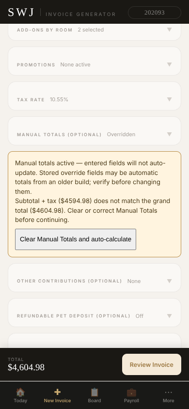
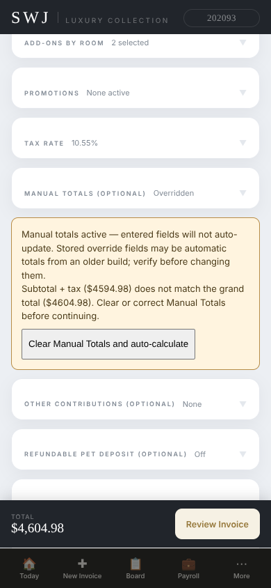
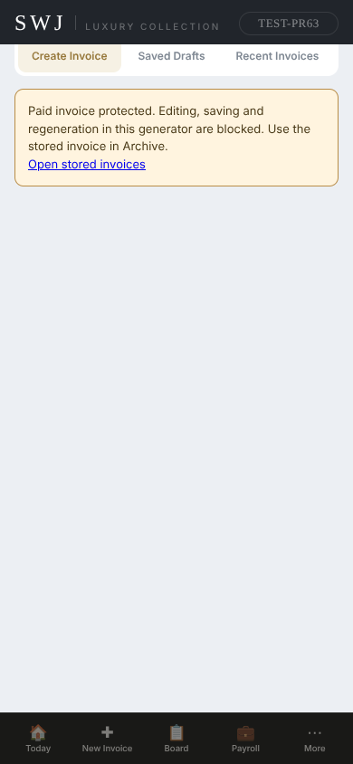
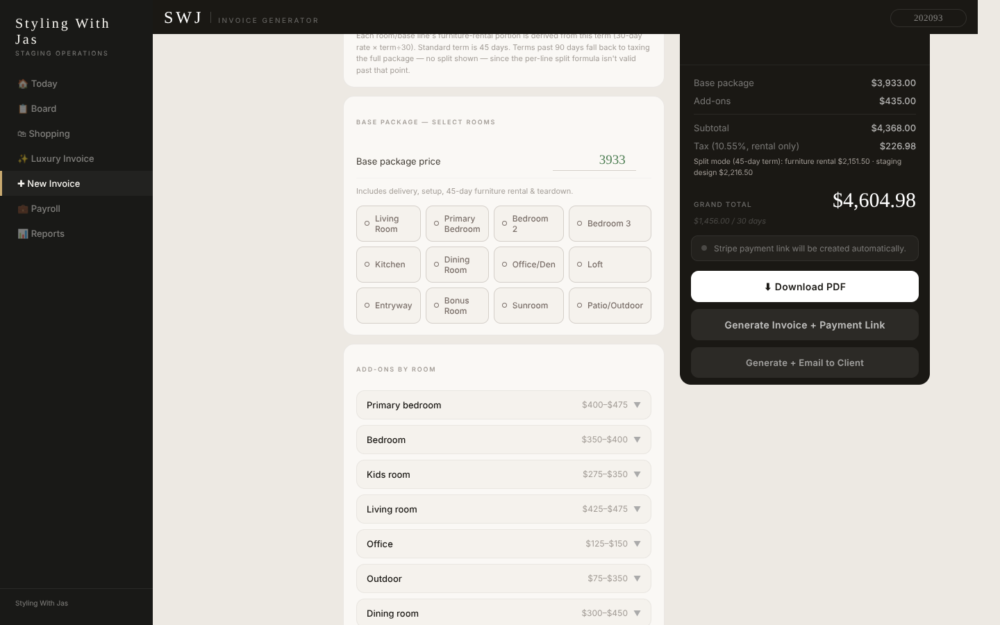
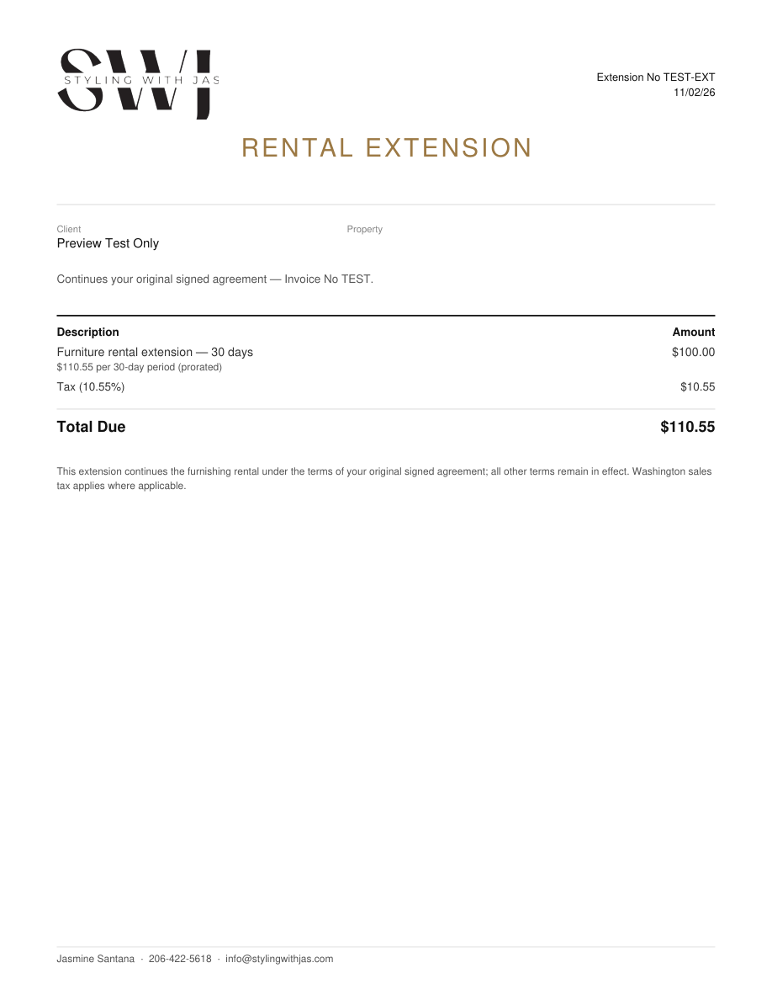
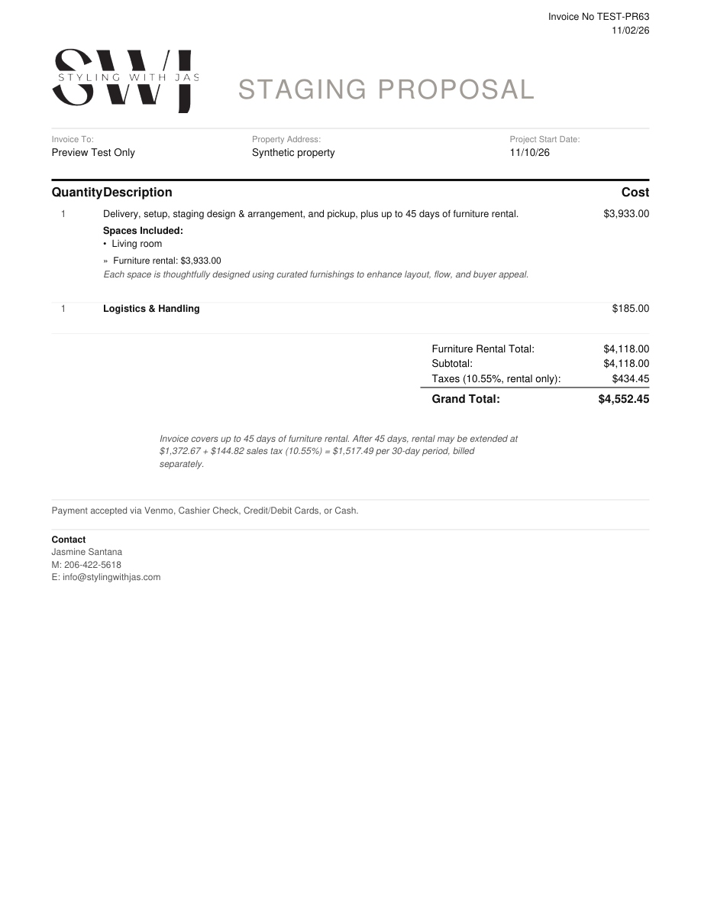

# PR 63 follow-up fixes — owner review

Preview only. No merge or production deployment is approved. This change does not include Section 7, Plaid, the Home redesign, a payroll expansion, pricing increases, the removed split toggle, legal TBD text, or a tax filing.

## Decisions and behavior

1. Both generators classify custom adjustment visits as service. The existing delivery/transport precedence stays intact. New records retain the chosen line type; historical classification readers were not changed.
2. One shared diagnostic checks lines/subtotal, tax/claimed taxable base, subtotal + tax/grand, and room-based extension/subtotal thirds. Only an explicitly entered tax override skips the tax/base equation. Manual subtotal and total fields never suppress arithmetic warnings.
3. The room summary and generated payload share one calculation. A grand-total-only override keeps rental-only tax and visible split totals. An inconsistent grand total blocks PDF creation, payment-link creation, emailing and draft saving until corrected. Other discrepancies show a prominent warning and an alert before output. No price is silently adjusted to make an override fit.
4. New automatic totals carry explicit override provenance; their Manual Totals inputs reload blank and auto-update. Older records cannot prove whether saved override fields were manual. Their values remain visible with a freeze warning and a one-click clear; unverified legacy tax fields do not automatically bypass the tax check. This is the explicit-warning alternative authorized by item 4, not an inference that old overrides were automatic.
5. Paid or partially paid invoices are blocked at generator load. Form cards and recalculated summary amounts are hidden; Archive remains available. A fresh paid-status check precedes Stripe-link paths. Server generation and saves independently check the canonical stored record. A receipt-state predicate on the update prevents a concurrent payment from being overwritten. Existing stored-data signature rendering and separate Board extension/balance notices remain available.
6. The only Payroll edits implement item 6: truthful collected-receipt and signature labels, source-fetch failure handling, pagination, and a visible comparison between all source receipts and the allocation view's excluded-job receipts. Allocation and tax formulas are unchanged.
7. Extension PDFs already printed dollar tax at nonzero rates. This follow-up verifies that output, also prints $0.00 tax at zero rates, and accepts a separately verified fee/tax/total breakdown from the Board. Old payloads retain their existing fallback. The base invoice's extension footer and contract clauses are unchanged.
8. Missing Board extension rates use the saved pretax subtotal / 3. Existing stored rates are retained, including explicit zero.
9. Proposal pages display saved per-line rental/service splits and matching split totals, in black, regular-weight text subordinate to room prices. No historical split is synthesized or saved.
10. Zero, blank, negative and fractional terms surface a validation error and block output rather than silently becoming 45. At 90 days, zero-dollar design detail is omitted; the math and per-line font/color remain unchanged.
11. The PDF bottom totals block is literal #000000. Per-line split font/color/weight are untouched.
12. Summary, draft save, download, generate, generate-and-email, actual email send, and Board extension billing have guard coverage. A malformed extension stops before Stripe or source writes.

## Finance diagnosis (item 6)

At the main-branch baseline, `finPaymentEvents()` already counts non-test payments by their received date, including unsigned paid invoices, legacy paid flags with a total fallback, and paid extensions. Collected receipts include sales tax. Signature status is **not** the receipt filter.

The view's per-month `excludeInvnums` can remove receipts from its allocation figure while the Tax Report includes them. The old invoice-fetch catch also replaced failures with an empty array, producing an apparently valid $0. Finally, the "Signed, unpaid, no staging date" label was unconditional on signature and therefore demonstrably false for unsigned quotes.

The follow-up displays the unfiltered receipt total and any budget-exclusion difference, reports unavailable source data instead of zero, and corrects the label. It does not silently reset month overrides. The exact cause of the owner's live October $0 requires inspecting that preview session's live data and overrides; source inspection and fixtures cannot prove which condition occurred there.

## Verification completed locally

- Python backend/PDF tests: paid and partial-paid protection, stale/concurrent-payment save conflicts, normal unpaid save, fail-closed lookups, failed-save reporting, extension amount validation, synthetic period totals, and actual PDF rendering/extraction.
- Offline application-DOM tests execute the actual generator, Board, Finance and Tax Report functions. Both generators pass adjustment, manual/frozen totals, clear action, $10 mismatch, zero/90-day terms, all output guards, and paid-lock checks. Board fallback/guard, proposal splits, and Finance/Tax Report cash receipt definitions also pass.
- Chromium browser tests run both actual generator pages using intercepted, synthetic data only. Mobile, tablet and desktop widths are checked for horizontal overflow. Warning and paid-lock screenshots are attached below.
- Existing `scripts/verify_full_backup_restore.py` remains passing against its original mock fixture.
- `tax-report.html`, `api/webhook.py`, and `TAX_METHODOLOGY.md` are unchanged. No client emails, Stripe calls, live database writes, or tax filings were performed by these tests.

### Synthetic financial comparisons

These are fixture checks, not certifications of live records.

| Scenario | Expected / verified |
| --- | --- |
| $4,118 lines; $2,151.50 rental; Seattle 10.55% | Tax $226.98; grand $4,344.98 |
| Add $250 adjustment visit | Service +$250; rental and tax unchanged; grand +$250 |
| $4,668 subtotal; $2,601.50 rental; 9.60%; total override $4,927.74 | Tax remains $249.74; arithmetic mismatch visibly blocks output |
| October received-amount fixtures | Finance and Tax Report $11,616.88 |
| August received-amount fixture | Finance and Tax Report $6,888.24 |
| September fixture before any paid markings | Both $0.00 |

### Test-only review images








## Owner preview gate — still required

- Repeat the $250 adjustment test in both generators.
- Repeat the exact $10 override, frozen $4,133 versus $4,118, tax-only mismatch, and loaded +$200 room cases.
- Verify paid protection with a **test-only** paid invoice. Do not test regeneration against a real paid invoice.
- Verify an existing unpaid invoice saves through the server guard on the preview deployment (including the PostgREST receipt-state predicates). This deployment-level integration cannot be established by mocked DB tests.
- Compare the live Tax Report: October $11,616.88; August $6,888.24; September $0.00 until the owner marks additional payments. Inspect Finance's selected month, any exclusions, and new source-status explanation.
- Open a preview-generated extension PDF and the proposal signing page. Confirm tax dollars and subordinate split styling. Do not send either to a client for testing.
- The supplied acceptance text ends at "Bonney Lake"; no missing rate/result was guessed. Confirm the remaining acceptance wording if it adds a separate requirement.

Only Gabe's explicit visual sign-off permits merging. Passing automated tests does not replace that gate.

## Running the checks

```sh
python -m unittest discover -s tests -v
python scripts/verify_full_backup_restore.py
# Optional offline DOM dependency, installed outside the application:
# npm install --prefix /tmp/swj-qa happy-dom
SWJ_HAPPY_DOM=/tmp/swj-qa/node_modules/happy-dom/lib/index.js node tests/pr63-dom.mjs
# Chromium/Playwright are QA dependencies only, not a frontend framework change:
node tests/pr63-browser.cjs
```

`SWJ_CHROMIUM_EXECUTABLE` can point to an installed Chromium binary when Playwright's managed browser is unavailable. Every browser API/DB call is intercepted; do not remove interception to run these tests against live data.
