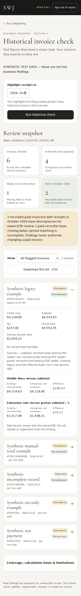
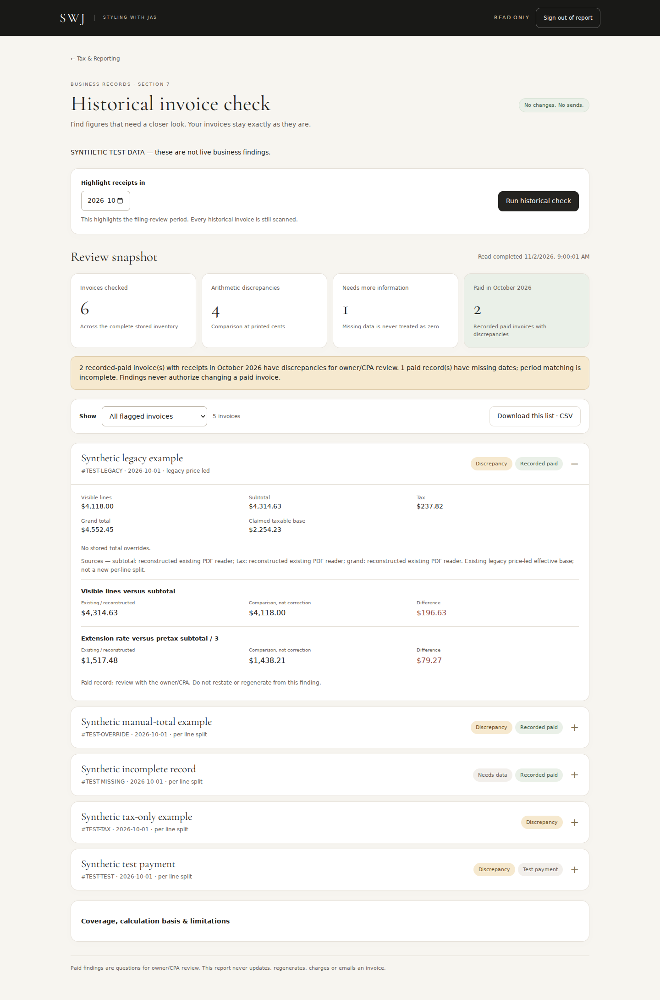

# Phase 1b — Section 7 historical invoice check

Preview branch: `codex/section7-historical-report`. Based on PR 63's merge, independent of Phase 0. No merge or production deployment is approved.

## What this builds

- `/reconciliation.html`: server-authenticated, read-only historical report, linked from Tax Report and Archive.
- Checks visible line prices against subtotal, tax against the record's claimed taxable base, printed subtotal + tax against grand, and extension rate against pretax subtotal / 3.
- Lists arithmetic discrepancies separately from missing/unverifiable inputs. A one-cent printed mismatch is reported; this is deliberately more sensitive than the generator's two-cent warning tolerance.
- Highlights recorded payments in a selectable review month (October 2026 by default), including partial payments; test payments are labeled and do not become live paid-period findings.
- Includes manual-total discrepancies without assuming that saved override fields prove manual intent. Rate-card extension differences carry context rather than silently applying room-based pricing policy.
- Uses the stored legacy price-led reader for old invoices. Modern term-derived split rules are never applied to them retroactively. Per-line split contradictions and nested extension breakdown problems are explicit findings.
- Downloads the exact filtered CSV prepared from the displayed snapshot. Exports do not reread a potentially changed database.
- A command-line route runs the same audit in an authorized server environment with no deployment or report-login configuration needed.

No source invoice is patched, restated, regenerated, charged, deleted, emailed or marked paid. No pricing, contract, payroll or tax-allocation formula is changed. The report does not block invoice generation or file returns. This change includes no Plaid integration, Home redesign or Phase 0 fixes.

## Fastest way to generate the real list

In an authorized checkout that already has the app's server environment:

```sh
python scripts/run_section7_report.py --review-period 2026-10
```

The script reads the existing `SUPABASE_KEY` environment variable and the existing application Supabase URL. **Do not paste credentials into chat, the command line, source code or a report.** No new database credential is requested.

It creates one JSON report, the all-findings CSV and the paid-review-period CSV, using unique filenames and owner-only filesystem permissions. By default they are outside the repository under the system temporary directory. Use `--output-dir /your/private/review-folder` for a chosen destination. The command never prints raw database records or keys. Missing configuration, incomplete coverage or a failed scan exits nonzero; it never reports a fake clean result.

This workspace does not contain the production `SUPABASE_KEY`, so **no actual historical invoice list was generated here**. All attached screenshots and fixtures are synthetic, clearly labeled test data.

## Web deployment configuration

The app currently has a browser-only password gate. Its localStorage flag and frontend password cannot authorize a server-side financial report. This build does not trust either.

The web report therefore requires one separate server-side administrator setting:

- `SWJ_REPORT_ADMIN_PASSWORD`: a new, high-entropy value of at least 20 characters, stored only in secure Vercel server environment variables. Do not reuse the password exposed in the existing browser gate. This is a report access setting, not a new Supabase credential. Keep preview and production settings separate.
- Existing `SUPABASE_KEY`: the application's service-role JWT key, already used by the backend. The audit refuses anonymous or unrecognized key types because an RLS-filtered response cannot establish complete inventory. A future Supabase secret-key format must be supported explicitly rather than guessed to be privileged.

Until configured, the report stays locked and does not query records. The browser sends the report password only in a same-origin HTTPS POST, then clears the input. A 30-minute signed HttpOnly / Secure / SameSite=Strict cookie authorizes report reads. Signatures are domain-separated derivatives of the existing server key, bound to the report password, request host and deployment environment. Password rotation invalidates sessions. The token exists only in the secure HttpOnly cookie; neither token nor password is written to localStorage, sessionStorage, exports or logs. Logout clears the browser cookie; copied stateless tokens otherwise expire after 30 minutes.

The sign-in route has an eight-attempt/minute per-instance limiter. This is **not** a distributed serverless rate limiter. Configure shared edge throttling for report login before production use. Existing app authentication and database RLS are outside this feature's scope; this report does not claim to secure other existing endpoints.

The new routes share the existing webhook function, keeping the twelve-function count unchanged. Section 7 dispatch occurs before Stripe/cron handling and never falls through into those jobs, including when an unknown report action also supplies a cron parameter. Existing cron schedules and normal webhook behavior are unchanged.

## Coverage and interpretation

- Uses 250-row keyset pagination and exact counts; it does not stop merely because a server-capped page is short.
- Requires two matching full reads, with a SHA-256 fingerprint. Changing records, missing pages, duplicate identifiers, absent count headers, insufficient privilege or timeout produce an incomplete-scan error, not totals.
- Two matching passes are not a transactional database snapshot. Changes after reading remain possible; rerun after bookkeeping changes.
- The scanner has a 45-second budget and 100,000-row ceiling. Responses above 3.5 MB are rejected rather than truncated. Very large inventories require a transaction-consistent, read-only database audit; no rows are silently omitted.
- Known settings/review rows, drafts and GS Photography are excluded. Paid, unsigned, denied and closed-lost staging invoices remain in scope. Unknown row types are not silently dropped.
- The original issued/signed PDFs are not read. When no explicit total was stored, a value is labeled reconstructed under the existing renderer. Comparison amounts are diagnostics, not replacement invoice figures.
- A missing date does not become an invoice date or staging date. Paid records with unknown timing stay flagged as incomplete. Test payments do not become real receipts.
- This report cannot detect a record absent entirely from the database, including an unrecorded job such as Deji.
- Paid findings are questions for owner/CPA review, not code authorization to restate an invoice. No decision to amend or file is automated.

## Verification completed

- 38 Python tests pass: all four arithmetic checks, cent differences, legacy reconstruction, rate-card zero base/context, manual overrides, malformed/missing data, nonmutation, paid/test/partial receipts, inclusive extensions, safe exports, full pagination beyond 1,000 records, shortened pages, count/timeout/change failures, service-role gating, authenticated HTTP dispatch, cookie isolation/expiry/tampering, no cron/Stripe fallthrough, and the command-line outputs.
- A differential test compares reconstruction to the actual existing PDF-reader code over 102 fixtures; displayed subtotal, tax and grand match at printed cents.
- Chromium tests pass on the actual new UI: login, no browser-persisted credential, accurate server figures, month/view filters, byte-exact CSV export, stale-result removal on errors, logout and unconfigured states. Widths 360, 390, 768 and 1440 have no horizontal page overflow.
- The standalone patch also applies cleanly over the separate Phase 0 branch; all 48 combined Python tests pass.
- Existing full-backup restore fixture remains passing. Python compilation, JavaScript parsing and whitespace checks pass.
- No live database, Stripe, email or filing calls were made by these tests.

### Synthetic review screenshots




## Files changed

- `reconciliation.html`, `assets/section7.css`, `assets/section7.js`: report presentation.
- `lib/section7.py`: independent read-only diagnostics and CSV generation.
- `lib/section7_auth.py`: server-enforced report access.
- `lib/section7_http.py`: complete read-only scan and isolated HTTP dispatch.
- `api/webhook.py`: report dispatch only; existing jobs preserved.
- `vercel.json`: package server utilities, allow the scan budget and route the new page.
- `tax-report.html`, `archive.html`: a link to the report; existing calculations untouched.
- `scripts/run_section7_report.py`: deployment-independent read-only command.
- `tests/test_section7.py`, `tests/section7-browser.cjs`, `tests/make_section7_fixture.py`, `tests/fixtures/section7-report.json`, `tests/artifacts/section7-*.png`: synthetic verification.

## Owner gate

1. Apply this standalone patch on a preview branch. It can be developed before Phase 0 is merged; when combining branches, retain both sets of independent server utilities and Vercel include rules.
2. Run the command in an authorized server environment to obtain the actual list, or configure the report's secure web sign-in on preview and scan there.
3. Confirm the record count covers the full application table and compare several known stored invoices, including an original legacy-price-led record and a manual override. Confirm paid October findings and unknown payment dates separately.
4. Verify an unauthenticated browser cannot read the report endpoint. Confirm no source record changed before/after scanning and CSV export.
5. Review the preview visually and explicitly sign off before any merge or production deployment.

The GitHub connection available here denied writes in Phase 0. This package is ready for an authorized checkout to publish; it does not claim a preview deployment or PR exists.

## Reproducing tests

```sh
python -m unittest discover -s tests -v
python scripts/verify_full_backup_restore.py
python tests/make_section7_fixture.py
node tests/section7-browser.cjs
```

Browser QA uses Playwright/Chromium as test-only dependencies. `SWJ_CHROMIUM_EXECUTABLE` can point to an installed Chromium binary. Every API is intercepted in browser tests; do not remove interception to run fixture tests against a live database.
